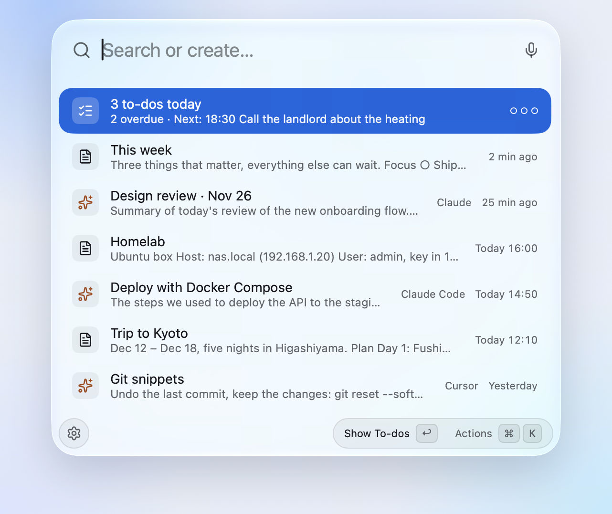
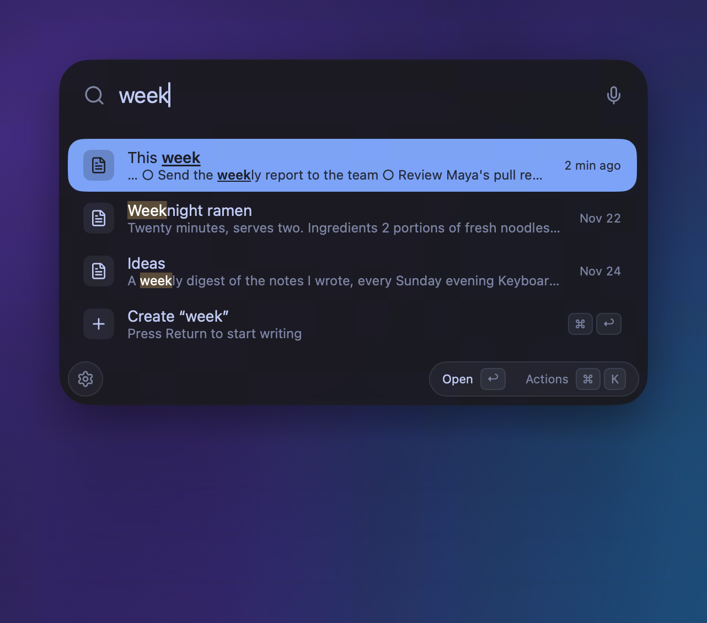

<p align="center">
  
</p>

# Jot

Quick notes for macOS that you share with your AI apps.

[Website](https://madcodelife.github.io/jot/) · [Download](https://github.com/madcodelife/jot/releases/latest) · [Install](#install) · [中文](README.zh-CN.md)

Double-press ⌥ anywhere and a floating panel appears. Its one field is both the search box and the title of a new
note: type, and either find what you wrote before or press Return to start a new one. Notes are plain Markdown files in
a folder you choose, and your AI apps (Claude, Cursor, Codex, …) search, read and add to the same notes, so you and
they keep one notebook between you.

<p align="center">
  
  
</p>

- **Summon from anywhere** — double-press ⌥, search and create from the same field, Esc and it is gone.
- **Markdown, previewed live** — as Typora does: the syntax shows only where the caret is. Saved as you type.
- **To-dos in your notes** — `- [ ] pay rent tomorrow 9am` becomes a reminder with a notification. Times are read in
  English, Chinese and Japanese.
- **Shared with your AI apps** — connect Claude Code, Claude, Cursor, VS Code, Windsurf, Codex or Gemini CLI in one
  click; a note an app writes carries its name.
- **Plain files, yours** — one `.md` file per note, in iCloud Drive or any folder. No account, no server, no analytics.

## Install

On a Mac (Apple silicon or Intel):

```sh
curl -fsSL https://madcodelife.github.io/jot/install.sh | sh
```

It downloads the latest release for your Mac, puts `Jot.app` in `/Applications` (or `~/Applications` when
`/Applications` is not writable) and opens it. Your notes are not touched.

Jot then updates itself: it checks for a new release in the background and downloads it, and the panel's footer and
the menu bar's menu offer to restart into it (quitting Jot installs it too). Settings → About checks at once. Running
the install command again also updates it.

Or download `Jot-<version>-macos-arm64.zip` (Apple silicon) or `Jot-<version>-macos-x86_64.zip` (Intel) from the
[releases](https://github.com/madcodelife/jot/releases), unzip it and move `Jot.app` to Applications. Jot is not
notarized by Apple, so run `xattr -dr com.apple.quarantine /Applications/Jot.app` once before opening it.

## Use

- **Open the panel**: double-press ⌥. The first time, macOS asks for Accessibility access, which the double-press
  needs; without it, ⌃⌥J opens the panel.
- **Find or create**: with nothing typed, today's to-dos sit above your pinned notes and then your recent ones,
  grouped by day. Type to filter notes by title and body; when nothing matches, Return creates a note with that title.
- **Act on a note**: ⌘K on a row to open, rename, give it an emoji, pin it to the top (⇧⌘P), copy, show in Finder,
  lock or move it to the Trash (with undo).
- **To-dos**: type `todo` (or `/todo`) for every open to-do, grouped by when it is due; ⇧⌘D changes a reminder's time.
- **Dictation**: hold ⌥ to talk into the search field or a note; double-press and hold ⌥ in any app for a quick note.
- **Lock a note**: ⌘K → Lock makes it read-only for Jot, your AI apps and every other program (Finder's "Locked").
- **Bring your Apple Notes**: Settings → General → Import copies every note in Notes (all accounts and folders) into
  Jot as Markdown, with its date. Importing again adds only the new ones. Locked notes, images and attachments stay
  in Notes.
- **Connect your AI apps**: Settings → AI Apps, one click each. Then ask them things like "jot this command down",
  "remind me to send the weekly report on Friday" or "what's on my list today?".

Light and dark, with Jot's default in macOS system blue, GitHub, One, Dracula, Tokyo Night, Catppuccin, Gruvbox and
High Contrast themes. In English, Simplified and Traditional Chinese and Japanese.

## Your notes

- One note is one `.md` file in the notes folder, named after its title. The folder is `iCloud Drive/Jot` when iCloud
  Drive is on, else `~/Documents/Jot`; Settings changes it.
- A reminder is written into the note as a plain time, `- [ ] pay rent ⏰ 2026-11-14 09:00`, and a checked to-do gets
  its date, `- [x] pay rent ✅ 2026-11-14`.
- A note an AI app creates starts with frontmatter naming it (`source: claude`); your own notes have none. A note's
  emoji is in its frontmatter too (`icon: "🍜"`), and so is a pin (`pinned: true`).
- Jot does no syncing itself: keep the folder in iCloud Drive, Dropbox or Syncthing.

More in [docs/storage.md](docs/storage.md).

## Privacy

- Your notes are plain files in a folder you pick. Jot has no account, no server and no analytics, and sends your notes
  nowhere.
- It goes online for one thing: every 6 hours it asks GitHub whether a new release is out. No notes go with it.
- Importing from Apple Notes reads Notes on this Mac, only when you press Import (macOS asks you first).
- Dictation uses Apple's speech recognition, which may process your voice on Apple's servers, depending on your Mac and
  the language.
- The AI apps you connect read your notes through `jot-mcp`, and send what they read to their own model providers, on
  their own terms.
- A folder in iCloud Drive, Dropbox or Syncthing is synced by that service, not by Jot.

## AI apps and MCP

Jot.app carries `jot-mcp` (`Jot.app/Contents/MacOS/jot-mcp`), an MCP server that works on the notes folder whether or
not Jot is running. Settings → AI Apps connects the apps it finds on this Mac. For any other MCP app, copy the entry
that page shows, or write it by hand:

```json
{
  "mcpServers": {
    "jot": {
      "command": "/Applications/Jot.app/Contents/MacOS/jot-mcp",
      "args": ["--dir", "~/Documents/Jot"]
    }
  }
}
```

| Tool | What it does |
|---|---|
| `search_notes(query, limit?)` | Search titles and bodies |
| `read_note(title)` | Read a note in full |
| `recent_notes(limit?)` | The most recently modified notes |
| `create_note(title, body)` | Create a note, marked with the app's name |
| `append_note(title, text)` | Append to a note |
| `add_todo(text, due?, note?)` | Add a to-do; `due` is an ISO local time or a phrase such as `tomorrow 3pm` or `明天 9点` |
| `list_todos(range?)` | Open to-dos: `overdue`, `today`, `upcoming` or `all` (default: today's and overdue) |
| `complete_todo(note, text)` | Check off a to-do |
| `reschedule_todo(note, text, due)` | Change a to-do's reminder time; `null` removes it |
| `trash_note(title)` | Move a note to the Trash (only while you allow it) |
| `replace_note(title, body)` | Rewrite a note, its previous version going to the Trash (only while you allow it) |

Removing and rewriting stay off until you turn on Settings → AI Apps → "Allow AI apps to move notes to the Trash and
rewrite notes"; what an app takes away goes to the Trash, where you can get it back. No tool changes a locked note.
How connecting, the switch and locks work: [docs/mcp.md](docs/mcp.md) and [docs/locks.md](docs/locks.md).

## Building

Jot is built with [NSH](https://github.com/longbridge/nsh): the UI is TSX, the notes store, the reminders and the
platform code are Rust. [CONTRIBUTING.md](CONTRIBUTING.md) sets it up and lists the commands;
[docs/architecture.md](docs/architecture.md) maps the code.

## Credits

The theme colors are adapted from these VS Code themes, all under the MIT license:
[GitHub Theme](https://github.com/primer/github-vscode-theme),
[One Dark Pro](https://github.com/Binaryify/OneDark-Pro) and [Atom One Light](https://github.com/akamud/vscode-theme-onelight),
[Dracula](https://github.com/dracula/visual-studio-code) (its light version Alucard from the
[Dracula specification](https://github.com/dracula/dracula-theme)),
[Tokyo Night](https://github.com/enkia/tokyo-night-vscode-theme),
[Catppuccin](https://github.com/catppuccin/vscode) and [Gruvbox](https://github.com/jdinhify/vscode-theme-gruvbox).
Jot picks their colors for a notes panel rather than a code editor and adjusts some to meet WCAG AA contrast.

## License

[MIT](LICENSE)
